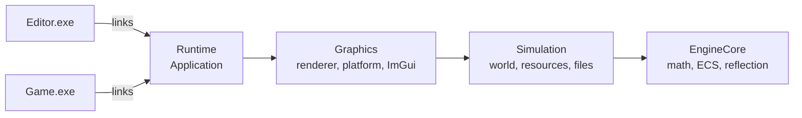
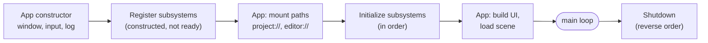

# Application and Subsystems

**In one sentence:** `Application` owns every engine-wide service, creates them in a fixed order, and drives their hooks in that order every frame.

## Executables and engine layers

Each executable subclasses `Application` and provides `CreateApplication()`. The engine never knows which app it runs; it only calls virtual hooks. Editor-only code is excluded from the game **by target**, not by `#ifdef` (see [Decision Log](../Reference/Decision%20Log.md)).

## Startup in phases

**Why Register and Initialize are separate:** the app gets a window between them to configure subsystems (mount paths) before they start. At Initialize, everything registered earlier is ready to call.

## Who holds the subsystems

`Application` inherits them from `SubsystemHost`, a window-free base class in the lowest layer. A subsystem only ever sees the host, which is what lets it live below graphics. The two that need more (renderer, ImGui) are handed the window when they're registered.

## Order is behaviour

Registration order: **File → Reflection → Resource → World → Render → ImGui**.

- Every per-frame hook runs in this order, and shutdown runs in reverse.
- So World updates before Render reads the scene, and ImGui draws after Render (on top).
- Dependents shut down before their dependencies.

| Subsystem | Does | Requires |
|---|---|---|
| `FileSubsystem` | Maps virtual paths to disk | `engine` and `project` mounted before initialization |
| `ReflectionSubsystem` | Owns the type database | Nothing |
| `ResourceSubsystem` | Loads and caches CPU-side assets by virtual path | `FileSubsystem`, a loader for the extension |
| `WorldSubsystem` | Owns the active `Scene`, loads scenes, ticks them | `ResourceSubsystem`, `FileSubsystem`, `ReflectionSubsystem` (passed to `SceneLoader`) |
| `RenderSubsystem` | Turns `View`s into pixels, owns the `GraphicsDevice` | `ResourceSubsystem`, `WorldSubsystem` |
| `ImGuiSubsystem` | Runs the ImGui frame | The application window |

## The NVI shape (seen everywhere)

Base classes own *when* a hook runs (private, non-virtual drivers). Subclasses own *what* it does (protected virtual `On*` hooks). The same shape repeats in subsystems, `Scene`, `Entity`, `Component` and the window. Once you recognise it, you can read any of them.

## How systems find each other

| Mechanism | Used for |
|---|---|
| `GetSubsystem<T>()` | subsystem ↔ subsystem |
| **Constructor injection** | everything that isn't a subsystem (UI, panels, loaders). The default. |
| Static handle (`Log`, `Input`, `Reflection`) | rare global services. Must pass the [global handle test](../Reference/Where%20Things%20Go.md) |

> [!tip] Ownership is separate from access
> A static handle never owns anything. A subsystem (or `Application`) owns the instance and *publishes* it for the duration of its lifetime.

## Where to next

- [Frame Lifecycle](Frame%20Lifecycle.md): what those hooks actually do in one frame.
- [Platform Layer](Platform%20Layer.md): the window and input created during startup.
- [Where Things Go](../Reference/Where%20Things%20Go.md): deciding whether something new should be a subsystem.
- Back to the [Engine Map](../Engine%20Map.md).
