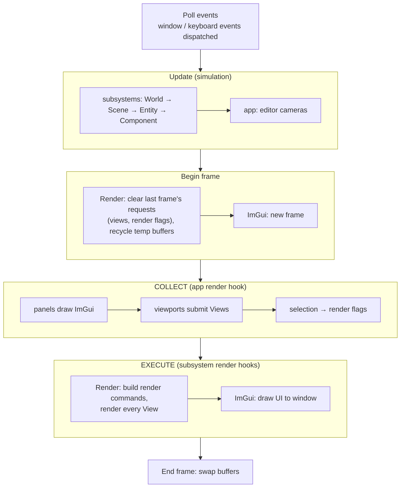
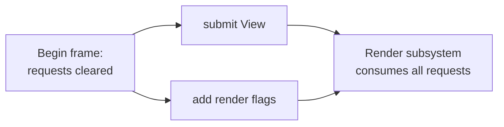

# Frame Lifecycle

**In one sentence:** each frame is *events → update → render*, and render is split into **collect** (requests are recorded) and **execute** (the renderer consumes them all at once).

> [!tip] The most important page
> If you can draw this from memory, you can place almost any feature. "It runs at the wrong time" bugs are answered here.

## One frame

## Collect, then execute

The renderer never draws when asked. It **records requests** in the collect window and **executes them all** later:

- A request made **before** the clear is lost. One made **after** execute is too late.
- This is the same shape a future **render thread** needs: one side records, the other executes.

> [!warning] Fragile contract (flagged for refactor)
> The collect window exists only because of where hooks happen to be called. Inside the editor's render hook, the selection must be submitted **after** the panels ran, because ImGui is immediate mode: clicks, Delete and Ctrl+Z are handled *while* panels draw. An explicit "submit to renderer" phase would make this visible instead of implicit.

## Two surprises

- **The viewport shows this frame's image even though its ImGui call comes before rendering.** ImGui only *records* "draw this texture". The texture is filled during execute, and ImGui draws it afterwards.
- **Update's delta time is in milliseconds**, not seconds.

## Game build

The Game app submits **no views** today, so it shows only its ImGui window. See [Known Oddities](../Reference/Known%20Oddities.md).

## Where to next

- [Scene and ECS](../Data/Scene%20and%20ECS.md): what runs during update.
- [Rendering Pipeline](../Rendering/Rendering%20Pipeline.md): what happens inside execute.
- [Editor](../Editor/Editor.md): the panels and viewports that fill the collect window.
- [Application and Subsystems](Application%20and%20Subsystems.md): why the hooks run in this order.
- Back to the [Engine Map](../Engine%20Map.md).
