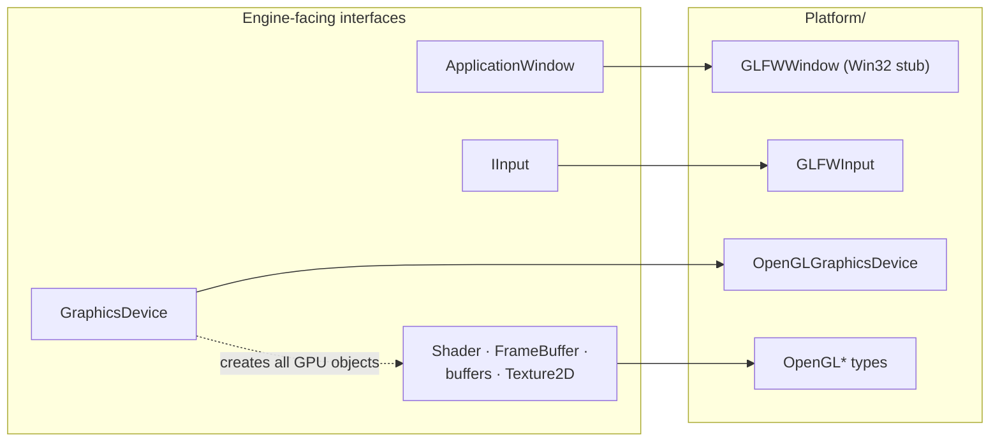
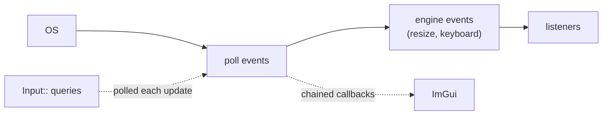

# Platform Layer

**In one sentence:** the engine talks only to abstract interfaces. `Platform/` is the only code that knows GLFW and OpenGL.

> [!important] The load-bearing rule
> Nothing in `Renderer/` includes OpenGL. The abstraction exists so the planned **DirectX 12** backend can be a new `Platform/DX12/` folder, not a renderer rewrite.

## Interfaces and implementations

- **One factory per interface** switches on a backend enum. It's the only place that names a concrete type.
- **All GPU objects are created through the device.** Callers never name an OpenGL type.
- The Render subsystem owns the one device.

## OpenGL concepts kept inside the device

- **VAOs** don't exist in the interface. The device builds and caches them per (vertex buffer, instance buffer) pair when drawing.
- **Pipeline state** (depth test, writes, depth function) is set explicitly by each pass. Nothing restores state for you.

> [!important] Cross-file contract: attribute locations
> The order of attributes in a vertex buffer layout **is** the GLSL `layout(location = N)`. The mesh vertex layout and the shader templates must agree, and instance attributes continue numbering after the vertex ones. Changing one side silently breaks the other. See [Shaders and Materials](../Rendering/Shaders%20and%20Materials.md).

## Events vs input

- **Events** (resize, keys) are dispatched to listeners by event type.
- **Input** is *polled* through a static facade. Cameras use this.
- ImGui installs its own GLFW callbacks *chained* with the engine's, so both see input.

## Where to next

- [Rendering Pipeline](../Rendering/Rendering%20Pipeline.md): the main user of the graphics device.
- [Shaders and Materials](../Rendering/Shaders%20and%20Materials.md): the other half of the attribute location contract.
- [Application and Subsystems](Application%20and%20Subsystems.md): who creates the window and input.
- Back to the [Engine Map](../Engine%20Map.md).
