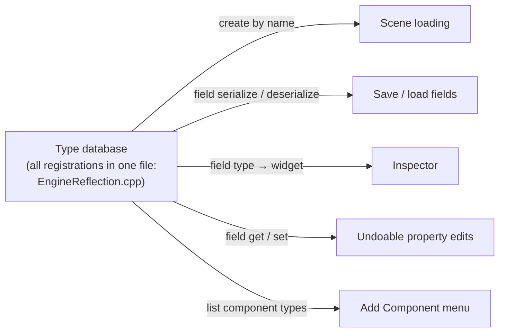
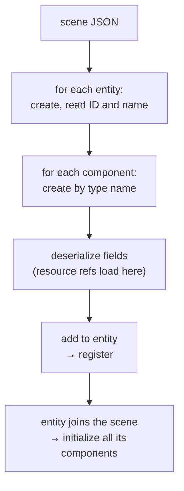

# Reflection and Serialization

**In one sentence:** each type is described **once** (name, base, factory, fields), and scene loading, saving, the Inspector, undo and "Add Component" all work from that one description.

## One description, many consumers

Adding a field to the registration gets you all five consumers. **Forgetting to register it gets you none of them, silently.** Reflection is opt-in per field.

## Key ideas

- **Fields are closures, not offsets.** Each field captures how to get, set, save and load itself. Nothing downstream needs the concrete type.
- **Inheritance by copying:** a type receives its base's fields at registration. So bases must be registered **before** derived types (`Object` → `Component` → components). Otherwise the inherited fields are silently missing.
- **Resource references** serialize as paths but have no get/set yet, so the Inspector shows a placeholder and edits to them can't be undone.
- The type database is reached through a **static handle**: it's single, frozen after startup, and needed from template code. The Reflection subsystem owns it.
- **Every component must be default-constructible.** The factory only ever creates one with no arguments; configuration comes from reflected fields or the initialize hook.
- **RTTI must stay on.** A live component's type is found with `typeid`.

## Archive: one API for both directions

A thin wrapper around a JSON node. The same code path writes and reads, one serializer per value type.

> [!warning] Missing keys are skipped silently
> Old files stay loadable, but **a typo in a key name just leaves the default value**. There's a live example in [Known Oddities](../Reference/Known%20Oddities.md).

## Loading a scene

Components are **fully loaded before they're added**, and an entity joins the scene only once all its components are attached. So initialize hooks see final values, resolved resources and their siblings, whatever the order in the file.

Some components override serialization for the file format, e.g. transform rotation is radians in memory and degrees on disk.

## Where to next

- [Editor](../Editor/Editor.md): the Inspector and undo, built on these descriptions.
- [Resources and Files](Resources%20and%20Files.md): what a resource reference resolves to.
- [Scene and ECS](Scene%20and%20ECS.md): the entities and components being described.
- Back to the [Engine Map](../Engine%20Map.md).
