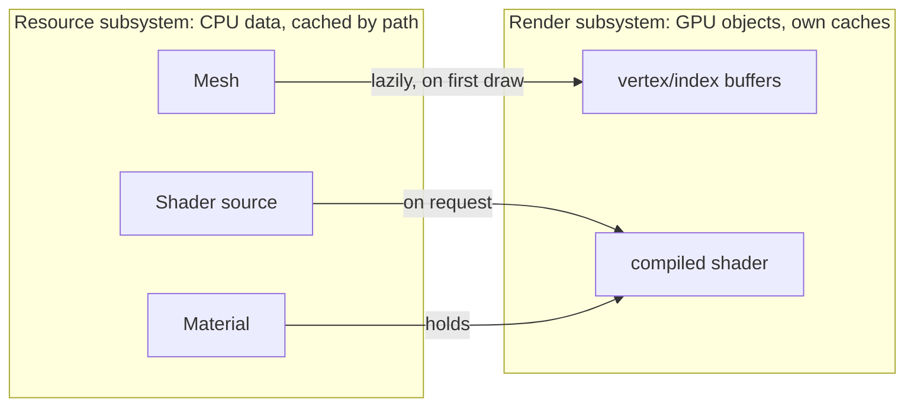

# Resources and Files

**In one sentence:** code asks for assets by **virtual path**. The File subsystem maps that to disk, and the Resource subsystem picks a loader by extension, builds CPU-side data and caches it by path.

## Virtual paths

| Mount | Points to | Mounted by |
|---|---|---|
| `engine://` | `Engine/Assets` | the engine itself |
| `project://` | `Game/Assets` | each app |
| `editor://` | `Editor/Assets` | the editor |

**Why:** references inside data files (scenes, materials) stay valid wherever the engine or project lives on disk. Switching projects is a mount change, not a data change.

## Loading

Loaders are registered per extension and can take extra constructor dependencies.

| Extension | Becomes |
|---|---|
| `.glsl` | shader **source** (includes expanded) |
| `.png` `.jpg` | pixels |
| `.obj` | vertices + indices |
| `.mat` | a material: a **GPU shader** + uniform values |

## CPU data vs GPU objects

- **Resources are plain data** and know nothing about the GPU. The renderer creates GPU objects from them when needed.
- **Materials are the exception:** they hold a compiled shader. That's why the material loader depends on the renderer and is registered after it.

## Components reference resources by value

A component field of type `ResourceRef<T>` is **saved as a path** and **resolved synchronously while the scene loads**. So by the time a component initializes, its resources are loaded. Only the Resource subsystem can fill in the resolved pointer.

## Where to next

- [Shaders and Materials](../Rendering/Shaders%20and%20Materials.md): the resource type with the most machinery.
- [Reflection and Serialization](Reflection%20and%20Serialization.md): how resource references get saved and resolved.
- [Rendering Pipeline](../Rendering/Rendering%20Pipeline.md): where CPU data becomes GPU objects.
- Back to the [Engine Map](../Engine%20Map.md).
