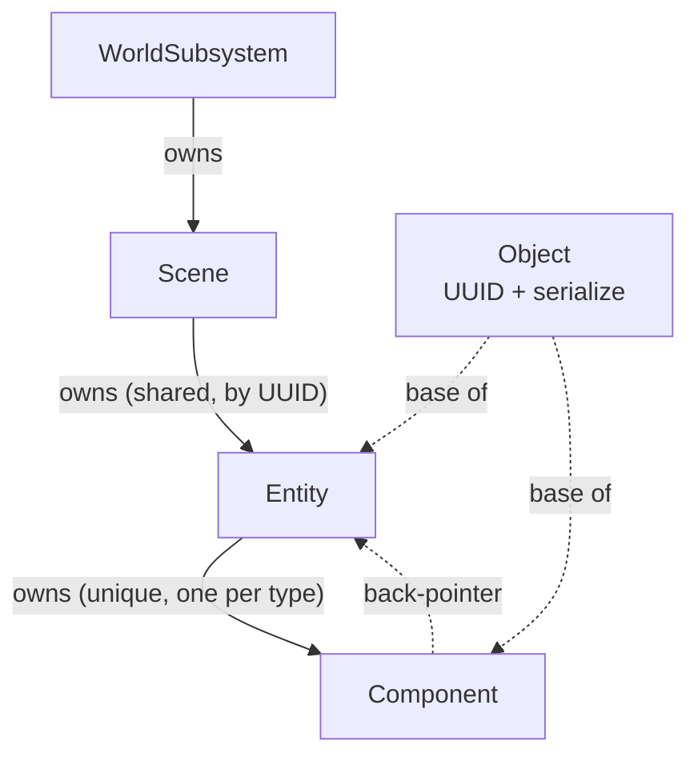
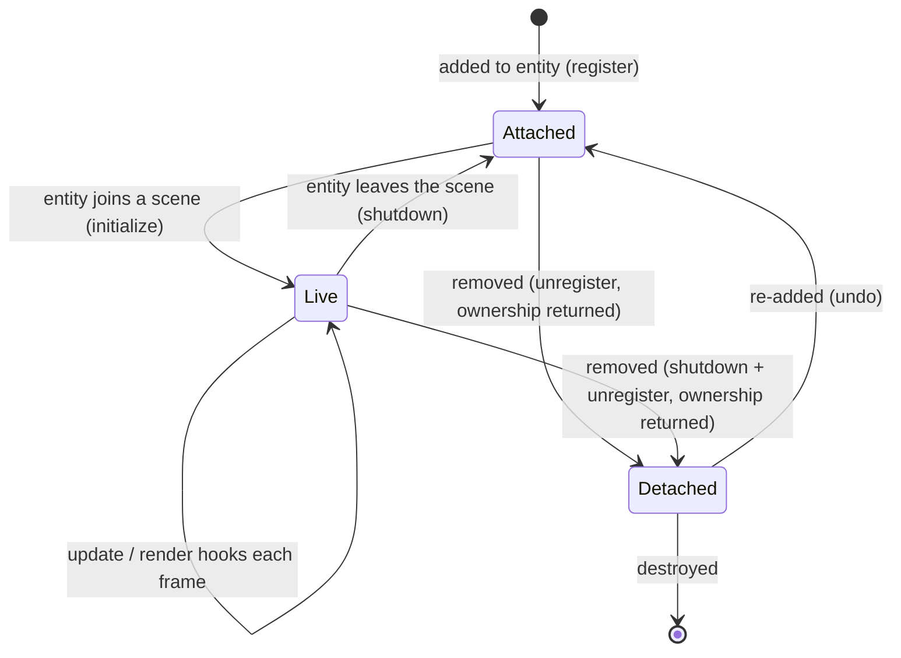
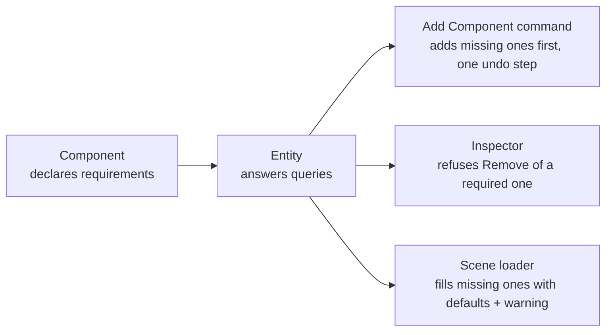

# Scene and ECS

**In one sentence:** the World subsystem owns one `Scene`, which owns entities by UUID, and each entity owns at most one component per type. Lifecycle hooks flow down that tree every frame.

## Ownership

**Why entities are shared and components unique:** removing an entity or component *returns ownership* instead of destroying it, so an undo command can hold it and put it back. The API was shaped by undo.

## An "object-style" ECS, on purpose (for now)

| | Axiom today | Classic data-oriented ECS (Phase 3) |
|---|---|---|
| Entity | object with UUID string | integer ID + generation |
| Components | inside each entity's type map | one dense array per type |
| "All meshes" query | visit every entity, hash lookup each | iterate one array |
| Behaviour | virtual hooks on components | systems iterate arrays |

The "all components of type T" query runs every frame in the renderer. It's the hot path Phase 3 is meant to measure and replace.

## Lifecycle

> [!note] Initialize waits for the whole entity
> A component can look up its siblings in its initialize hook whatever order they were added in, so component order in a scene file doesn't matter. Two limits: a component added to an entity already in a scene initializes straight away, so a sibling can still be missing, and other entities may not exist yet.

## Required components

A component type declares the sibling types it can't work without (a mesh, a light and a camera need a transform). `Entity` only answers questions about that: which components require a type, and what a component is missing. The rules live with the callers that change entities:

So a component can trust its requirements instead of checking for them. Code calling `Entity` directly bypasses all three; see [Known Oddities](../Reference/Known%20Oddities.md).

## Conventions

- **A component type lives next to the system that consumes it.** Mesh, camera and light components are in `Renderer/`; only generic ones (transform) are in `Scene/`.
- Entity and component maps are **unordered**, so Outliner order and draw order are arbitrary.
- **No hierarchy yet** (parent/child). It's the critical-path item in [EditorUX](../Editor/EditorUX.md).

## Where to next

- [Reflection and Serialization](Reflection%20and%20Serialization.md): how components get loaded, saved and inspected.
- [Resources and Files](Resources%20and%20Files.md): the assets components point at.
- [Rendering Pipeline](../Rendering/Rendering%20Pipeline.md): the per-frame reader of mesh components.
- [Editor](../Editor/Editor.md): undo, the reason removing returns ownership.
- Back to the [Engine Map](../Engine%20Map.md).
