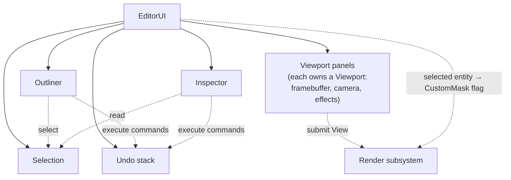
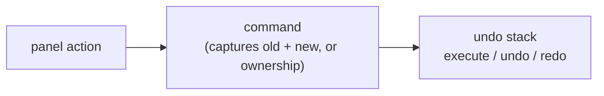

# Editor

**In one sentence:** the Editor app owns a UI root that holds the selection, the undo stack and the panels. Panels get their dependencies by constructor injection and change the scene only through undoable commands.

> [!note] ImGui is the editor UI
> Decided 2026-10-15, with no GUI switch before engine v1. ImGui only draws the panels; editor **logic** (selection, commands, asset list) lives in `EditorCore`, where ImGui can't be included. Code goes there only if it means something without the UI, so a gizmo drag stays in the viewport panel. See [Decision Log](../Reference/Decision%20Log.md).

## Ownership and dependencies

- Panels never reach for globals. Shared editor state lives in `EditorUI`, not in the engine.
- **The engine knows nothing about selection.** It only receives a render flag. See [Decision Log](../Reference/Decision%20Log.md).

## Viewports

Each frame a viewport fills a View from its camera and framebuffer, submits it, shows its texture, and resizes if the panel changed. **Only the focused viewport's camera** reacts to input. Effects such as the selection outline are attached **per viewport**.

## Undo: the Command pattern

- **A command owns everything it needs to reverse itself.** That's why the engine's remove operations return ownership.
- Executing a new command drops the redo history.
- Commands today: create entity, delete entity, add component, edit property.

## Inspector: generated from reflection

- One widget per reflected field, chosen by field type. No per-component UI code.
- **One undo entry per drag, not per frame:** the value previews live while dragging; on release, a single property-edit command records old → new.
- "Add Component" lists every reflected component type the entity doesn't have yet.

## Outliner

Lists entities (unordered). Click selects, double-click renames (an undoable property edit on the reflected name), right-click creates, Delete deletes and clears the selection.

## Where to next

- [Reflection and Serialization](../Data/Reflection%20and%20Serialization.md): what the Inspector is generated from.
- [Post-Processing](../Rendering/Post-Processing.md): how the selection outline is drawn.
- [Frame Lifecycle](../Core/Frame%20Lifecycle.md): why selection is submitted after the panels run.
- [EditorUX](EditorUX.md): the intended editor experience.
- Back to the [Engine Map](../Engine%20Map.md).
