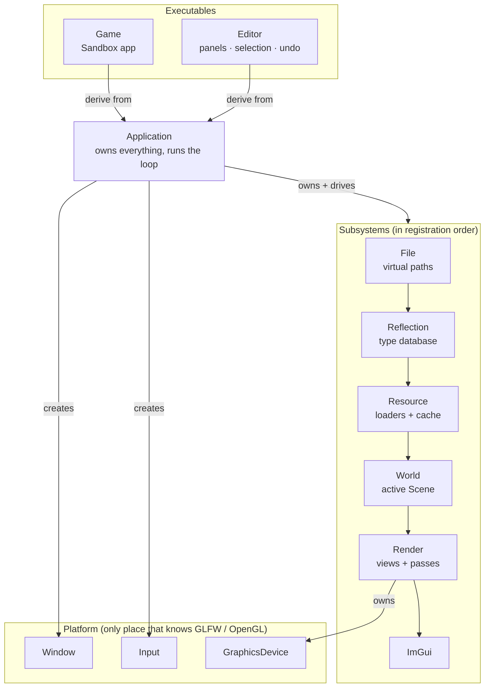

# Engine Map

Start here when you've lost the big picture. These pages describe **design, ownership, data flow and decisions**. For signatures and details, read the headers.

> [!tip] How to use these notes
> - **Lost?** [Frame Lifecycle](Core/Frame%20Lifecycle.md). Everything hangs off one frame.
> - **Reading through?** Start at [Application and Subsystems](Core/Application%20and%20Subsystems.md) and follow "Where to next" at the bottom of each page.
> - **Looking for something, or adding something?** [Where Things Go](Reference/Where%20Things%20Go.md).
> - **Wondering "why is it like this?"** [Decision Log](Reference/Decision%20Log.md).
> - **Want the picture?** [Engine Map.canvas](Engine%20Map.canvas).
> - **Need a signature or usage example?** Hover the class in your IDE, or open the Doxygen reference with the VS Code task "Doxygen: Open".
> - **What does the editor do today?** The living specs in `openspec/specs/`. **What's next?** The [Roadmap](../Roadmap.md).

## The engine in one diagram



## Pages

| | Page | Question it answers |
|---|---|---|
| **Core** | [Application and Subsystems](Core/Application%20and%20Subsystems.md) | Who owns what? How do systems find each other? |
| | [Frame Lifecycle](Core/Frame%20Lifecycle.md) | What runs when, inside one frame? |
| | [Platform Layer](Core/Platform%20Layer.md) | How are GLFW / OpenGL hidden? |
| **Data** | [Scene and ECS](Data/Scene%20and%20ECS.md) | Scene → Entity → Component |
| | [Resources and Files](Data/Resources%20and%20Files.md) | Virtual paths, loaders, CPU vs GPU data |
| | [Reflection and Serialization](Data/Reflection%20and%20Serialization.md) | One type description, many consumers |
| **Rendering** | [Rendering Pipeline](Rendering/Rendering%20Pipeline.md) | From components to pixels |
| | [Shaders and Materials](Rendering/Shaders%20and%20Materials.md) | Templates, variants, materials, reload |
| | [Post-Processing](Rendering/Post-Processing.md) | Effect chain, custom mask, selection outline |
| **Editor** | [Editor](Editor/Editor.md) | Panels, selection, undo |
| | [EditorUX](Editor/EditorUX.md) | The intended editor experience (intent, not always as built) |
| **Reference** | [Where Things Go](Reference/Where%20Things%20Go.md) | Where is it, how do I reach it, where does new code go? |
| | [Known Oddities](Reference/Known%20Oddities.md) | Bugs, leftovers, traps |
| | [Decision Log](Reference/Decision%20Log.md) | What was chosen, instead of what, and why |

## Source tree

```
Engine/Core/        EngineCore: Math · core types · Reflection · Serialization · Scene
Engine/Simulation/  Simulation: file, reflection, resource and world subsystems
Engine/Graphics/    Graphics: Renderer · Platform · Event · Input · ImGui · Geometry
Engine/Runtime/     Runtime: Application, entry point, engine type registration
Engine/Assets/  engine://   shaders (+ Include/ templates), materials, textures
EditorCore/src/ EditorCore: commands, undo, selection, gizmo math
Editor/src/     EditorApp: Editor app, EditorUI, panels, Viewport
Editor/Main.cpp the Editor executable's entry point
Tests/          AxiomTests (doctest): Logic · Runtime (real Editor) · Harness
Game/src/       Sandbox app
Game/Assets/    project://  scenes, meshes, project shaders
```

## Glossary

| Term | Meaning |
|---|---|
| **Subsystem** | Engine-wide service owned by `Application`, with frame hooks |
| **Virtual path** | `engine://…` / `project://…`, resolved to disk by the File subsystem |
| **Resource** | CPU-side asset data, cached by virtual path |
| **Reflection** | Runtime description of types and fields; drives serialization, Inspector, undo |
| **View** | "Render the scene from this camera into this framebuffer, then run these effects" |
| **Render command** | One mesh + material + transform + flags, rebuilt every frame |
| **Render flags** | Per-entity, per-frame bits: "this object also goes into pass/buffer X" |
| **Custom mask** | Engine-provided per-view texture marking objects with the CustomMask flag |
| **Shader variant** | Same shader source compiled with extra `#define`s |
| **Post-process effect** | Full-screen pass(es) attached to a viewport |
| **Command** | Undoable editor action on the undo stack |
