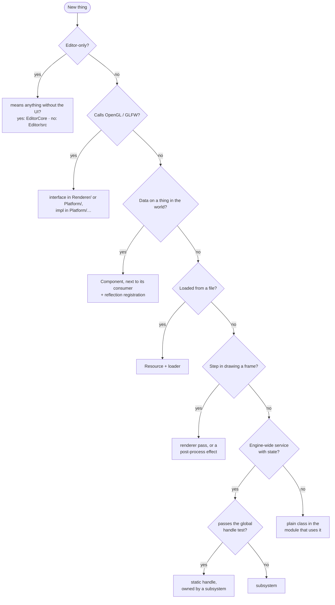

# Where Things Go

**In one sentence:** where existing things live, how to reach them, where new code goes, and what the most common changes touch.

## Finding what already exists

| I want to… | Go to |
|---|---|
| Add a main menu item or editor shortcut | `EditorUI`, in its render function |
| Add a panel | new class in `Editor/src/UI/Panels/`, created by `EditorUI` |
| Attach an effect to a viewport | `ViewportPanel`'s constructor, so every viewport gets it |
| Change a colour, size or font, or style one widget differently | `EditorTheme` (`Editor/src/UI/EditorTheme.h`). Panels call its named helpers and never push ImGui style themselves |
| Change the default panel layout | arrange the panels, close the Editor, copy `Editor/UserSettings/imgui.ini` (gitignored, the user's layout) over `Editor/Assets/Layouts/DefaultLayout.ini`. `EditorUI` loads it on first run and on View → Reset Layout to Default |
| Pick the icon for a component or entity type | `EditorIcons` (`Editor/src/UI/EditorIcons.h`). Icon names come from `IconsFontAwesome6.h` |
| Add an undoable action | new command in `EditorCore/src/Commands/` |
| Open a native file dialog | `Editor/src/Platform/FileDialog.h` |
| Add a logic test | doctest case in `Tests/Logic/`, in the `logic` suite. It can reach `EngineCore` and `EditorCore` only |
| Add a test against the real Editor | case using the `RuntimeTest` fixture in `Tests/Runtime/`, in the `runtime` suite, one file per scenario. Test code stays out of the `Editor` project |
| Change how runtime tests boot, reset or step frames | `Tests/Harness/` |
| Add a test-only component type or test scene | `Tests/Harness/TestComponents.h` (registered by the harness's reflection registrar, so it exists only in `AxiomTests`); scenes in `Tests/Assets/`, reached as `tests://` |
| Make a component require a sibling | override its requirements getter (see the `Component` header). The Add Component command, the Inspector and the scene loader enforce it |
| Change which scene loads at startup | `Editor` or `Sandbox`, in the app's run hook |
| Mount a path like `project://` | the app's register hook; `engine://` is mounted in `Application` |
| Build UI at startup | the app's initialize hook |
| Load or save a scene | `WorldSubsystem`, which drives `SceneLoader` and `SceneWriter`, in `Scene/WorldSubsystem.h` |
| Turn a dialog's physical path into a virtual one | `FileSubsystem`, in `Core/FileSubsystem.h` |
| Compare a virtual path or key a cache by one | `ToLower`, in `Core/StringUtils.h`; keep the original string for storing and showing the path |
| List the files a resource field can point to | `ListResourceCandidates`, in `Editor/src/UI/ResourceCandidates.h` |
| Read or write JSON values | `Archive`, in `Serialization/Archive.h` |
| Register a component or field | `Reflection/EngineReflection.cpp` |
| Register a subsystem or resource loader | `Core/Application.cpp` |
| Check the shared engine types | `Core/Types.h` |
| Find scene files | `Game/Assets/Scenes/` |

## Reaching it from your code

| You're in… | Use |
|---|---|
| An `Application` subclass or a subsystem | `GetSubsystem<T>()` |
| A panel, loader or other plain class | a constructor parameter; the caller passes it in |
| Anywhere | the static handles: `Log`, `Input`, `Reflection` |
| A component | its entity (`GetEntity()`), then sibling components |

## Placing something new

## Which library

Pick the lowest library the code can live in. An include from a higher layer is a compile error.

| Library | Holds | Can't see |
|---|---|---|
| `EngineCore` | math, core types, reflection registry, serialization, Entity / Component / Scene | everything above |
| `Simulation` | file, reflection, resource and world subsystems; CPU-side resources | Graphics, Runtime |
| `Graphics` | renderer, platform, input, events, ImGui, render components, materials | Runtime |
| `Runtime` | `Application`, the entry point, engine type registration | Editor, Game |
| `EditorCore` | editor logic that means something without the UI: commands, undo, selection, gizmo math | ImGui, Simulation and up |
| `EditorApp` | the Editor: UI, panels, viewports, gizmo interaction | test code |

## Principles

| Principle | Means |
|---|---|
| **Dependencies point down** | See [Which library](#which-library). The engine never includes editor code; the renderer never includes GL; the product never depends on test code. |
| **Generic mechanism, specific caller** | The engine offers a mechanism (render flags, custom mask); the editor is one caller (selection). |
| **Owner ≠ accessor** | One owner; everyone else borrows. A global never owns. |
| **Constructor injection by default** | Dependencies are passed in, not looked up. |
| **CPU data vs GPU objects** | Resources are data; the renderer makes GPU objects from them. |
| **Collect, then execute** | Frame-phase systems take requests early and consume them later. |
| **Per-frame render data carries no ECS pointers** | Identity crosses into the renderer as a UUID; commands carry baked values. |
| **Undo shapes the API** | Removing returns ownership; edits go through reflected setters. |
| **Components live near their consumer** | Render components sit in `Renderer/`. |

## The global handle test

Use a static handle only if **all four** hold; otherwise make it a subsystem:
1. **Single:** exactly one instance, ever (no edit vs play world).
2. **Frozen:** nothing writes to it after startup.
3. **Unreachable contexts:** needed where a reference can't be passed (templates, static utilities).
4. **No runtime swap.**

Log and the reflection database pass. Resources, rendering and the world don't.

---

## What each change touches

**Component type:** class next to its consumer · registration in `EngineReflection.cpp` · the scene file (field names must match exactly). *You get* loading, Inspector, Add Component and undo for free.

**Subsystem:** class in the lowest library it fits, taking the host in its constructor · registration **at the right position** in `Application` (order = update order, shutdown reversed) · dependencies only on earlier subsystems.

**Resource type:** resource (CPU data only) + loader in `Resources/` · register the extension after anything the loader needs · a `ResourceRef<T>` field to use it from a component · any GPU object is created lazily by its consumer.

**Render pass inside a view:** a place in the per-view sequence · a pooled buffer if it needs a target · a render-flag bit if it only wants some objects · set **all** GPU state it relies on.

**Render flag:** new bit (must name a pass/buffer) · the requester adds it every frame inside the collect window · the pass filters by **its own** bit.

**Post-process effect:** class (engine if reusable) · shader on the full-screen template · attach to a viewport in the editor UI · follow the [effect contract](../Rendering/Post-Processing.md): early-out leaves the image untouched, write back yourself, release every acquire.

**Material shader:** `.glsl` on the mesh templates · a `.mat` pointing at it · referenced from a mesh component.

**Editor panel:** class in `Editor/src/UI/Panels/`; its constructor takes **only what it needs** · created by the editor UI.

**Undoable action:** a command capturing old values or ownership · execute must be repeatable (redo calls it again) · panels never mutate the scene directly.

**Reflected field type:** touches four modules: the value variant and type enum (reflection), the type tag (reflection fields), a serializer (archive), a widget (Inspector).

## Where to next

- [Decision Log](Decision%20Log.md): why the rules are what they are.
- [Known Oddities](Known%20Oddities.md): where the code doesn't follow them yet.
- [Application and Subsystems](../Core/Application%20and%20Subsystems.md): how systems find each other.
- Back to the [Engine Map](../Engine%20Map.md).
