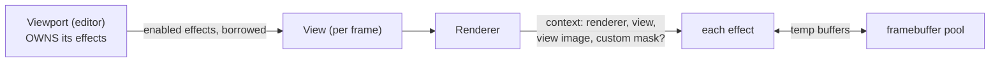
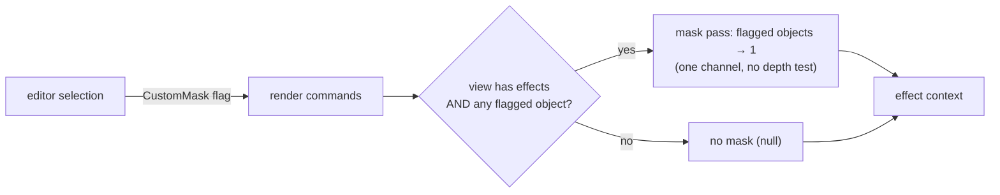
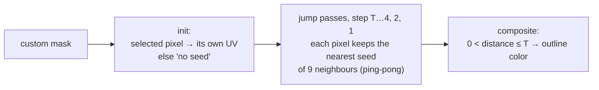

# Post-Processing

**In one sentence:** each viewport owns a chain of effects, and the renderer runs them on the view's image after the scene is drawn, handing them a context that includes an optional **custom mask** of flagged objects.

## Who owns what

- The View is a per-frame value, so it **borrows** effects; the Viewport owns them.
- Effects live in the engine when reusable (the outline does); a game can write its own.

## The effect contract

- An effect reads the view's image and writes its result **back into it itself**.
- It can't read and write the same texture in one pass (a feedback loop), so it renders into a pooled scratch buffer and copies back.
- **An effect with nothing to do just returns.** The image stays untouched and it costs nothing.
- Every pool acquire needs a matching release. Nothing enforces it; a missing release leaks a GPU buffer **every frame**.

Trade-off: effects know the copy-back protocol. Switching to ping-pong buffers later means changing every effect.

## The framebuffer pool

Temp buffers are borrowed per frame and matched by size and format. The **same GPU texture comes back every frame**, so per-frame acquisition costs nothing. A buffer unused for a few frames is freed, so resizing doesn't pile up allocations.

## The custom mask: an engine scene texture

- Like scene color or depth, it's **produced by the renderer** and available to any effect. Unreal's Custom Depth is the model.
- **Null means "nothing flagged"**. Effects that need it early-out.
- No depth test yet, so it includes hidden parts (x-ray). See [Known Oddities](../Reference/Known%20Oddities.md).

## Selection outline: Jump Flood

Every pixel ends up knowing **where the nearest selected pixel is**. The outline is just a distance band, so its width is constant in pixels at any zoom.

| Choice | Why |
|---|---|
| Store **pixel-center UVs** | they're never exactly 0, so (0,0) is a safe "no seed" value |
| 16-bit **unorm**, not half float | half floats can't hold exact pixel positions above ~2048 px |
| Read with integer texel fetches | filtering would blend coordinates into fake seeds |
| Compare distance **in pixels** | UV distance stretches with the aspect ratio |
| Start step = smallest power of two ≥ thickness | pixels further than T don't matter, so a few passes instead of ~11 |
| Steps must be **powers of two** | any distance is a sum of distinct powers of two, which is JFA's correctness argument |
| Skip "no seed" and out-of-screen candidates | otherwise everything snaps to the corner |

**Planned:** a different style for occluded parts. Mask gets a second "visible" channel (depth-tested against the scene), and the composite reads it **at the seed pixel**. JFA itself doesn't change.

## Where to next

- [Editor](../Editor/Editor.md): viewports own the effects, and selection drives the outline.
- [Rendering Pipeline](Rendering%20Pipeline.md): render flags and where the chain runs.
- [Shaders and Materials](Shaders%20and%20Materials.md): the full-screen template effects are written on.
- Back to the [Engine Map](../Engine%20Map.md).
