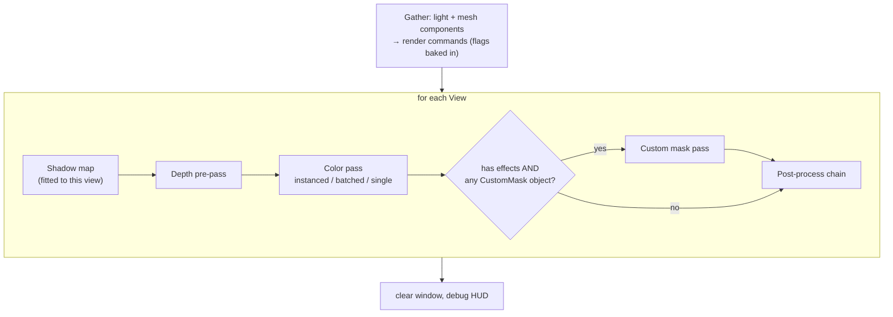
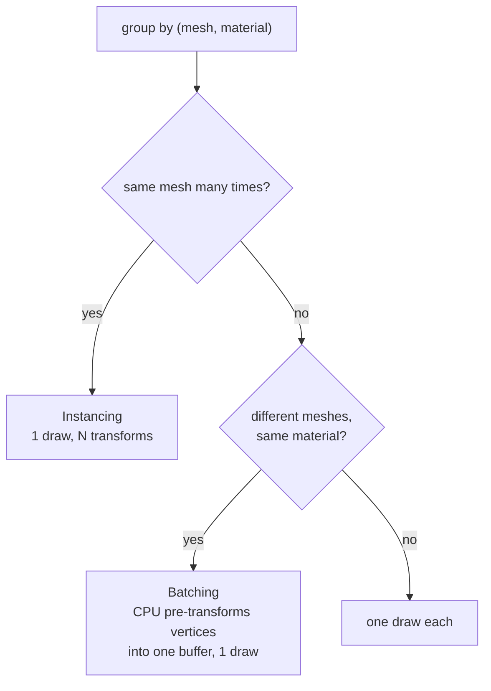

# Rendering Pipeline

**In one sentence:** every frame the Render subsystem turns mesh components into render commands, then renders each submitted View: shadows, depth pre-pass, color pass, custom mask, then the view's post-process chain.

## Per-frame data and its lifetime

| Data | Built by | Lives | Carries |
|---|---|---|---|
| **View** | whoever owns a camera (editor viewport) | one frame | camera matrices, target framebuffer, size, effects to run (borrowed) |
| **Render command** | renderer, from each visible mesh component | one frame | mesh, material, transform, render flags. **No entity pointer.** |
| **Scene render data** | renderer | refreshed each frame | the directional light, time, transient flags per entity UUID |

The entity → command step is the **only** place that touches the ECS. Everything after it works on commands. That boundary is what a render thread would cut along later.

## A frame inside the renderer

## Passes: the ideas

- **Shadows:** one shared shadow map, **re-rendered per view**, because its frustum is fitted to *that* camera. Its center is snapped to shadow-map texels so shadows don't shimmer when the camera moves.
- **Depth pre-pass:** depth only, then the color pass tests "equal or nearer" without writing depth. Each pixel's expensive lighting runs once, for the closest surface.
- **Each pass sets the GPU state it needs.** Nothing is restored afterwards.

## Instancing vs batching vs single

Instancing costs a per-frame transform upload; batching costs CPU vertex work every frame. Both can be toggled to compare draw counts.

## Render flags

Per-entity, per-frame bits requested from outside the renderer (the editor marks the selection). They're stored by **entity UUID** in a side table, cleared every frame, and baked into each command during the gather.

> [!important] The rule for a new bit
> Each bit means **"include this object in pass/buffer X"**. A per-object *draw style* (wireframe-only, tint) is **not** a flag; it belongs on the material. A pass filters by **its own bit**, never by "has any flags".

Today: one bit, **CustomMask**, which feeds the custom mask. See [Post-Processing](Post-Processing.md).

## GPU caches

The renderer keeps its own caches: compiled shaders by path, GPU buffers per mesh, instance and batch buffers, temp framebuffers (pooled). Most are keyed by **raw pointers** and never evicted. That's fine while nothing unloads, and a stale-hit hazard once something does.

## Where to next

- [Shaders and Materials](Shaders%20and%20Materials.md): what each pass compiles and binds.
- [Post-Processing](Post-Processing.md): what runs after the color pass.
- [Frame Lifecycle](../Core/Frame%20Lifecycle.md): where the renderer sits inside a frame.
- [Platform Layer](../Core/Platform%20Layer.md): how the renderer stays free of OpenGL.
- Back to the [Engine Map](../Engine%20Map.md).
