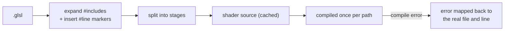

# Shaders and Materials

**In one sentence:** a `.glsl` file holds both stages, includes an engine **template** that owns `main()` and calls your hook, and compiles into **variants** on demand. A `.mat` file points at one shader and stores uniform values.

## Templates: the template method pattern in GLSL

| Template | For | You implement |
|---|---|---|
| mesh vertex + fragment templates | anything drawn on a mesh (materials) | vertex hook, fragment hook |
| full-screen template | post-process and JFA passes | fragment hook only; declare your own inputs |

The template owns attributes, transforms, varyings and output. So every material shader gets **instancing, depth-only and mask variants for free**, and every full-screen pass gets the quad setup for free.

Shared GLSL lives in `Engine/Assets/Shaders/Include/`.

## From file to GPU program

**Why the `#line` markers:** after include expansion, compiler line numbers refer to one big string. The markers plus a source map turn them back into `file(line)`.

## Variants: one source, many programs

A variant is the same source compiled with extra `#define`s, created on first use and cached inside the shader.

| Define | Means |
|---|---|
| `INSTANCED` | transforms come from per-instance attributes |
| `DEPTH_PASS` | skip the fragment hook, write depth only (shadows, pre-pass) |
| `CUSTOM_MASK` | skip the fragment hook, write "selected" (custom mask pass) |
| `HAS_DIRECTIONAL_LIGHT` | lighting + shadow sampling on |

**Why variants instead of separate shaders:** depth, shadow and mask passes reuse each material's **own vertex code**. If a material ever deforms vertices, every pass still matches what's on screen.

## Materials

- A material = one shader (shared by every material that uses the same path) + uniform values.
- Binding a material picks the variant and uploads all its stored uniforms.

> [!warning] Materials are mutated per draw
> The renderer writes per-object values (transforms) into the shared material right before each draw. Its "state" is whatever the last draw set. Fine single-threaded; a real hazard for a render thread.

## Errors and hot reload

- **Reload happens in place:** the shader object keeps its identity and swaps its program only if the new source compiles. Nothing needs re-resolving.
- **The error policy lives in the renderer:** a shader only knows "my last compile failed". The renderer substitutes a flashing-magenta error material for any invalid one.
- Trigger: Editor *Edit → Reload Shaders* (Ctrl+R), or the Game's ImGui button.

## Where to next

- [Post-Processing](Post-Processing.md): the full-screen template in use.
- [Rendering Pipeline](Rendering%20Pipeline.md): the passes that pick these variants.
- [Resources and Files](../Data/Resources%20and%20Files.md): how shader and material files get loaded.
- Back to the [Engine Map](../Engine%20Map.md).
