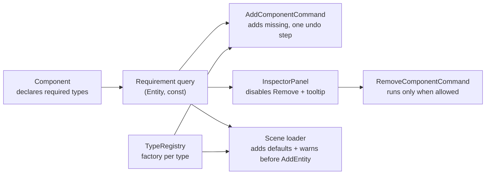

## Context

See proposal.md for the problem. Today an `Entity` stores at most one component per type and enforces nothing about combinations. Components look up siblings in `OnInitialize()` or every frame; `CameraController` caches its transform pointer, and `RenderSubsystem` reads the light's transform each frame behind a temporary error-and-no-light fallback. Components reach an entity three ways: the Inspector's Add Component (through `AddComponentCommand`), undo of a removal (through `RemoveComponentCommand`), and scene loading (`WorldSubsystem`), which adds components in file order before the entity joins the scene.

## Goals / Non-Goals

**Goals**
- One declaration per component type of what it requires, read by everything that checks it.
- Through the editor, an entity can't reach a state where a requirement is missing.
- A scene file that breaks a requirement opens with its missing requirements filled in and a clear warning, not a crash.

**Non-Goals**
- `Entity` enforcing requirements on every `AddComponent` / `RemoveComponent` call.
- Cascade removal, cross-entity requirements, alternatives ("A or B").

## Decisions

| Decision | Instead of | Why | Principle | Revisit when |
|---|---|---|---|---|
| A component declares its requirements with a virtual getter on `Component` returning a list of types; the default is empty | A list on `TypeDescriptor` filled in `EngineReflection.cpp`; a static getter copied into the descriptor | The declaration sits in the component's own header. Every place that checks it already has an instance: Add has the freshly built component, Remove and load have the entity's components | Information Expert (Larman, *Applying UML and Patterns*) | Something needs a type's requirements without an instance, such as listing them in the Add Component menu: move the list to `TypeDescriptor` |
| The editor commands enforce requirements; `Entity` stays a plain container | `Entity::AddComponent` adding missing requirements itself | Only a command can make "add X and what it needs" one undo step. Loading adds components in file order, so a check inside `Entity` would depend on that order and silently replace auto-created defaults | Separate mechanism from policy (Raymond, *The Art of Unix Programming*, Rule of Separation) | Game code starts assembling entities at runtime: add a check when an entity joins the scene |
| Removing a required component is refused, shown as a disabled menu item with a tooltip naming the components that require it | Removing the dependents along with it; refusing with a logged warning | The user can't lose more than they picked, and sees why before clicking | Judgment call (Unity's behaviour) | Multi-select remove arrives (E7) and a selection mixes required and free components |
| Adding a component adds its missing requirements first, recursively, and Undo removes all of them in one step | Refusing the add until the user adds the requirement by hand | Every reflected type has a factory, so a requirement can always be met; one click instead of a chore | Judgment call | A requirement can't be default-constructed sensibly |
| On scene open, a missing required component is added with default values and a logged warning, after all the entity's components are loaded and before it joins the scene | An assert; dropping the component that lacks its requirement; keeping the render-time fallback | An assert means a programmer error, and a bad file is data. Adding keeps everything the file holds (a light's colour and intensity), where dropping would delete it; the cost is an invented default (a transform at the origin) that is saved on the next Save. The warning keeps the repair visible. Checking after all components are loaded makes file order irrelevant; checking before the entity joins the scene means no component ever initializes without its requirements | Use assertions to prevent the impossible, not to validate input (Hunt & Thomas, *The Pragmatic Programmer*) | Scene files get versioning or migration, or a default is not a sensible stand-in for a missing requirement |
| One shared requirement query, as two `const` methods on `Entity`, used by the loader, the commands and the Inspector | Each caller walking the lists itself; a separate query file under `Scene/` | One definition of "missing" and "required by". `Entity` owns the components the query walks, sits in `EngineCore` (the lowest layer `Simulation`, `EditorCore` and `Tests/Logic` all see), and only answers questions, so the container stays free of policy | DRY (Hunt & Thomas, *The Pragmatic Programmer*) | — |
| `AX_ASSERT` takes a `std::format` message with arguments, formatted only on failure | A `Log::Error` before each assert; building the message string at the call site | One call names what failed (the type without a factory), and a passing assert costs nothing. The format string is checked at compile time | Judgment call | — |

**Requirement query.** It answers two questions about an entity: which of its components require a given type (for Remove and the tooltip), and which required types a component is missing (for Add and load). It reads the entity; it never changes it.

**Add.** When it is built, the command walks the new component's requirements, and theirs, creating each missing type once through the registry. Types are marked on the way down, which skips repeats and stops a requirement cycle; components are queued on the way back up, so each requirement comes before the component that needs it. Execute adds them in that order. Undo removes them in the reverse order, so a component always comes off before the ones it requires, and keeps the objects, so Redo restores the same ones with their values.

**Load.** After all of an entity's components are deserialized and added, and before `Scene::AddEntity` initializes them, the loader walks the entity's components as a work list. For each missing required type it creates a default through the registry, adds it to the entity, appends it to the work list and logs one warning. Appending is what checks an added component's own requirements; the walk ends because an entity holds at most one component per type. Nothing initializes before `AddEntity`, so the order in which components are added doesn't matter.

## Risks / Trade-offs

- [Code bypasses the check] `CreateComponent` and `AddComponent` called directly are unchecked → the renderer's light and mesh asserts catch it; a component such as the camera controller trusts its requirement and fails at its own null access. Components don't re-check requirements; one check when an entity joins the scene is the fix once game code assembles entities.
- [Required type isn't reflected] Add can't create it → assert in the command: a component declaring an unreflected requirement is a programmer error.
- [Dangling sibling pointers] still possible from code paths outside the commands → unchanged by this change; the remove refusal closes the editor path.

## What you'll need

- `Component` (`Engine/Core/src/Scene/Component.h`): the virtual requirements getter. Its usage comment shows how to declare a requirement.
- `Entity` (`Engine/Core/src/Scene/Entity.h`): the requirement query, `HasComponent(std::type_index)`, `GetComponents()`, `AddComponent` / `RemoveComponent`. A component added to a live entity initializes straight away, so required components must be added before the one that needs them.
- `TypeRegistry` (`Engine/Core/src/Reflection/Reflection.h`): `Reflection::Get().Find(type)` gives the descriptor; `TypeDescriptor::Create()` builds a component. `Find` returns null for an unreflected type.
- `AddComponentCommand` / `RemoveComponentCommand` (`EditorCore/src/Commands/`): the Remove header warns against running it while walking an entity's components. The Inspector already defers the removal with `pendingRemoval`.
- `InspectorPanel` (`Editor/src/UI/Panels/InspectorPanel.cpp`): `ImGui::MenuItem` takes an `enabled` flag. A disabled item only reports hover for a tooltip with `ImGuiHoveredFlags_AllowWhenDisabled`.
- Scene loading: the component loop in `WorldSubsystem.cpp`, before `m_scene.AddEntity(entity)`.
- The light and mesh transform asserts: `RenderSubsystem.cpp`.
- Tests: `Tests/Logic/Scene/ComponentRequirementsTests.cpp` for the query; `Tests/Runtime/AddComponentRequirementTests.cpp` and `SceneRequirementTests.cpp` for the command and loading. The runtime harness registers test-only components (`Tests/Harness/TestComponents.h`) and mounts `tests://` at `Tests/Assets`. A logged error fails a runtime case unless the case declares it.
